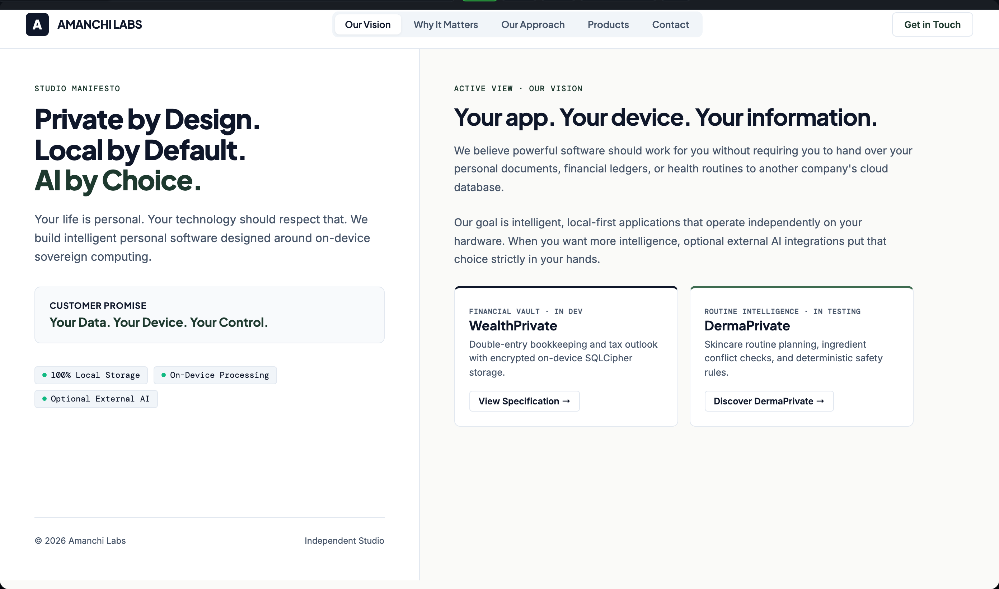
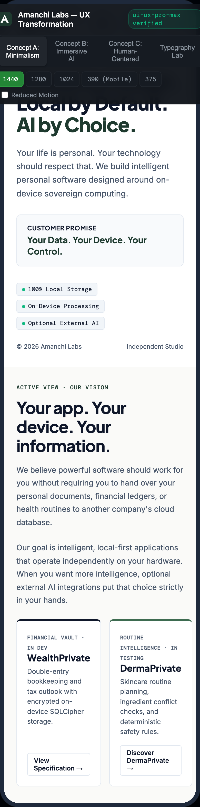
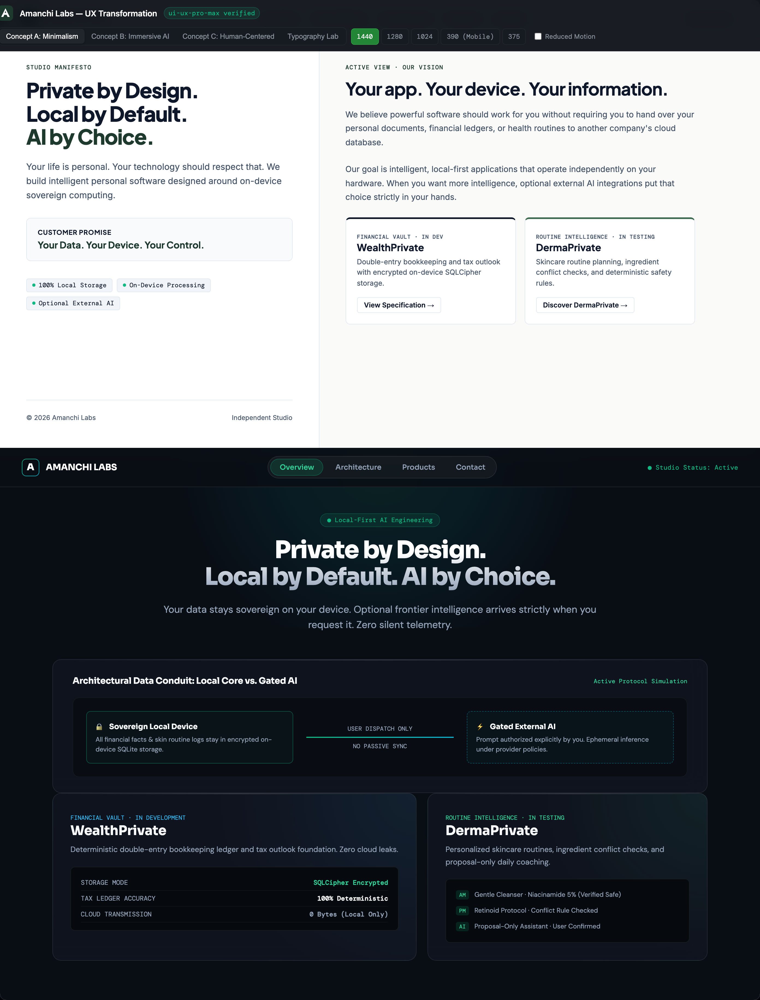
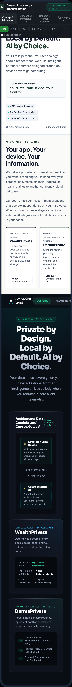
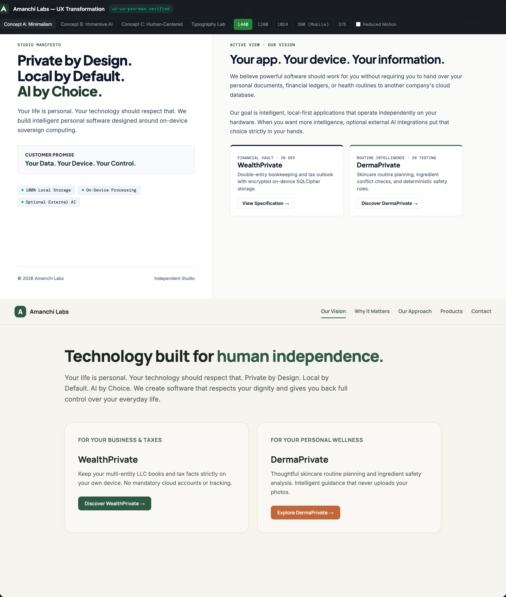
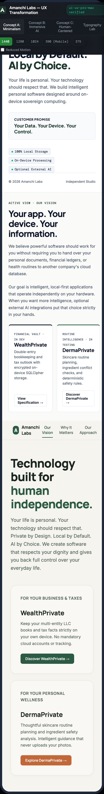
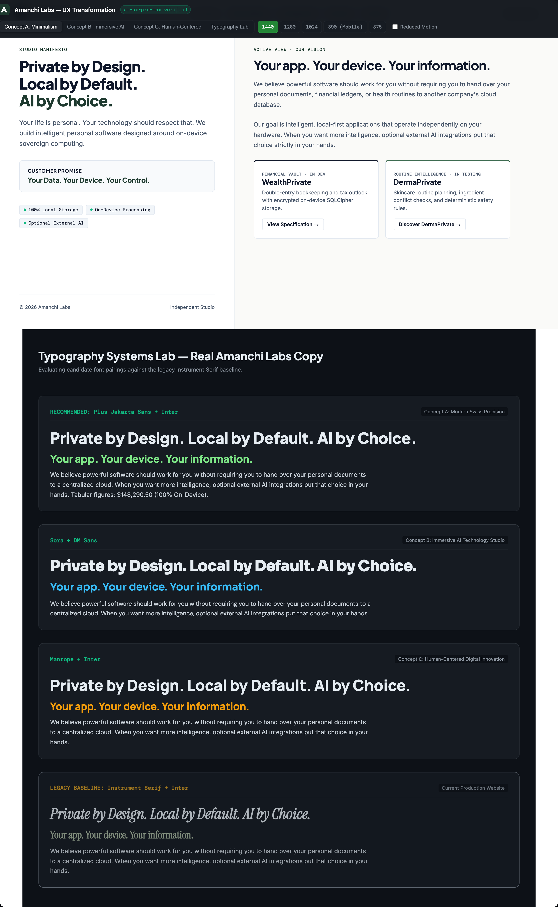

# Amanchi Labs — Complete Website UX/UI Transformation Review Package

**Status:** Owner Review & Concept Selection Gate  
**Date:** November 23, 2026  
**Agency Team:** Creative Director, Senior Brand Identity Designer, Principal UI/UX Designer, Typography & Visual Systems Expert, Interaction & Motion Designer, Frontend Design Architect, Accessibility Specialist, Conversion & Product Marketing Strategist  
**Repository Branch:** `feature/ux-transformation-nov23`  

---

## 1. Review Package Overview

This directory contains the complete multi-disciplinary agency assessment, design research, typography evaluations, three distinct creative concepts, high-fidelity visual mockups, and implementation roadmap for transforming the Amanchi Labs website from a restrained, document-like presentation into an elite, cutting-edge software studio experience.

```
docs/reviews/amanchilabs-ux-transformation/
├── README.md                            # Executive overview & review navigation (this file)
├── 01-current-site-audit.md             # Phase A: Independent comprehensive website audit
├── 02-design-research.md                # Phase B: Research & ui-ux-pro-max intelligence record
├── 03-typography-comparison.md          # Phase B: Typography systems evaluation & copy specimen
├── 04-creative-directions.md            # Phase C: In-depth exploration of Concepts A, B, and C
├── 05-recommended-direction.md          # Phase D: Multi-criteria evaluation & hybrid recommendation
├── 06-accessibility-performance-risks.md# Phase E: WCAG 2.2 AA audit & performance constraints
├── visual-comparison-gallery.html       # Standalone interactive prototype & concept switcher
├── capture-mockups.mjs                  # Reproducible Playwright capture script
└── img/                                 # High-fidelity visual mockups & comparison captures
    ├── concept-a-1440x900.png           # Concept A Desktop (Swiss Minimalism)
    ├── concept-a-390x844-mobile.png     # Concept A Mobile (Swiss Minimalism)
    ├── concept-b-1440x900.png           # Concept B Desktop (Immersive AI Studio)
    ├── concept-b-390x844-mobile.png     # Concept B Mobile (Immersive AI Studio)
    ├── concept-c-1440x900.png           # Concept C Desktop (Human-Centered Innovation)
    ├── concept-c-390x844-mobile.png     # Concept C Mobile (Human-Centered Innovation)
    └── typography-systems-comparison.png# Side-by-side headline specimen comparison
```

---

## 2. Reproducible Preview Instructions

### Option 1: Direct Interactive Browser Inspection (Zero Server Required)
You can directly open the standalone visual comparison gallery in any modern web browser:
```bash
# On macOS:
open docs/reviews/amanchilabs-ux-transformation/visual-comparison-gallery.html
```
- **Features in the Gallery:**
  - Switch interactively between **Concept A**, **Concept B**, and **Concept C**.
  - Simulate viewports with one click: **1440×900 (Desktop)**, **1280×800 (Laptop)**, **1024×768 (Tablet)**, **390×844 (Mobile)**, and **375×812 (Phone)**.
  - Test live in-place tab switching (`Our Vision`, `Why It Matters`, `Our Approach`, `Products`, `Contact`).
  - Inspect the **Typography Systems Lab** rendering real Amanchi Labs headlines with Google Fonts.
  - Test the **Reduced-Motion** accessibility toggle.

### Option 2: Local HTTP Server (Vite Preview or Python)
```bash
# Using Python 3:
python3 -m http.server 8080
# Open: http://localhost:8080/docs/reviews/amanchilabs-ux-transformation/visual-comparison-gallery.html

# Or using Vite dev server:
npm run dev
# Open the review path hosted locally
```

### Option 3: Re-generating Mockup Screenshots
To re-run the automated headless Chromium capture at any time:
```bash
node docs/reviews/amanchilabs-ux-transformation/capture-mockups.mjs
```

---

## 3. High-Fidelity Mockup Gallery

### Concept A: Modern Intelligent Minimalism (Swiss Precision & Architectural Grid)
*Display: Plus Jakarta Sans · Body: Inter · Canvas: Warm Studio Chalk `#FAFAF8`*

- **Desktop (1440×900):**  
  
- **Mobile (390×844):**  
  

---

### Concept B: Immersive AI Technology Studio (Layered Depth & Abstract Intelligence)
*Display: Sora · Body: DM Sans · Canvas: Deep Obsidian `#090D14` with Ambient Glow*

- **Desktop (1440×900):**  
  
- **Mobile (390×844):**  
  

---

### Concept C: Human-Centered Digital Innovation (Warm Organic Intelligence)
*Display: Manrope · Body: Inter · Canvas: Warm Limestone `#F6F4EE`*

- **Desktop (1440×900):**  
  
- **Mobile (390×844):**  
  

---

### Typography Systems Comparison Lab
*Live rendering of "Private by Design. Local by Default. AI by Choice." and product titles across all candidate pairings:*  


---

## 4. Key Takeaways & Recommended Decision

| Creative Concept | Character | Strongest Attribute | Recommended For |
| :--- | :--- | :--- | :--- |
| **Concept A** | Swiss Architectural | Surgical clarity, 100% WCAG AAA contrast, zero fluff | Purist high-performance studio |
| **Concept B** | Frontier AI Studio | Captivating depth, dark-vault product showcases, visual AI conduit | Cutting-edge technology studio |
| **Concept C** | Human-Centered | Empathetic warmth, organic curves, scenario storytelling | Wellness & lifestyle-forward |
| **RECOMMENDED HYBRID (A + B)** | **Precision Intelligent Studio** | **Swiss layout & typography (A) + Bento grid & dark/light product showcases (B)** | **The definitive studio direction** |

---

## 5. Strict Governance & Boundaries Confirmation

- [x] **Zero Production Code Modified:** All production components in `src/` remain completely untouched.
- [x] **No Unapproved Routing/Navigation Rewrites:** Routing architecture changes are documented in proposal specifications only.
- [x] **Brand Assets Preserved:** The approved architectural [A] mark is retained as the studio identity without modification.
- [x] **App Repositories Untouched:** WealthPrivate and DermaPrivate external repositories were not modified.
- [x] **No Fabricated Claims:** All copy adheres strictly to verified status (*DermaPrivate in testing*, *WealthPrivate in development*, local-first as a design principle, external AI with provider disclosures).
- [x] **Ready for Owner Selection:** Production implementation will begin only after the owner selects and approves a creative direction.
