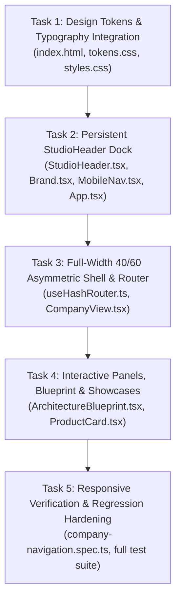

# Amanchi Labs Refined Concept A Implementation Plan

> **For agentic workers:** REQUIRED SUB-SKILL: Use superpowers:subagent-driven-development (recommended) or superpowers:executing-plans to implement this plan task-by-task. Steps use checkbox (`- [ ]`) syntax for tracking.

**Goal:** Transform the Amanchi Labs website into the officially approved Refined Concept A ("Modern Intelligent Minimalism") design, featuring a full-width responsive 40/60 asymmetric grid, Plus Jakarta Sans + Inter typography, persistent top studio navigation dock, dynamic in-place content panels, and sovereign architecture blueprints.

**Architecture:** Replace the traditional 240px fixed left sidebar and constrained document layout with an edge-to-edge full-viewport layout. The shell features a persistent 78px `StudioHeader` top dock with architectural `[A]` branding, an asymmetric 40/60 two-column body (40% grounded manifesto narrative, 60% dynamic in-place content canvas), and an updated lightweight hash router providing instant panel switching with zero scroll jumps and full browser history support.

**Tech Stack:** React 18, TypeScript, Vite, Vanilla CSS custom properties (design tokens), Google Fonts (`Plus Jakarta Sans`, `Inter`, `DM Mono`), Playwright E2E.

**Spec:** [docs/reviews/amanchilabs-ux-transformation/07-refined-concept-a-evaluation.md](file:///Users/veerrajuamanchi/amanchi-labs/amanchilabs/docs/reviews/amanchilabs-ux-transformation/07-refined-concept-a-evaluation.md), [docs/reviews/amanchilabs-ux-transformation/refined-concept-a.html](file:///Users/veerrajuamanchi/amanchi-labs/amanchilabs/docs/reviews/amanchilabs-ux-transformation/refined-concept-a.html), and Retina baseline mockups in [docs/reviews/amanchilabs-ux-transformation/img/](file:///Users/veerrajuamanchi/amanchi-labs/amanchilabs/docs/reviews/amanchilabs-ux-transformation/img/).

---

## Global Constraints

- **Design Baseline:** Strictly reproduce Refined Concept A as frozen in `docs/reviews/amanchilabs-ux-transformation/refined-concept-a.html` and commit `1426742`.
- **Screen Utilization:** 100% full-width edge-to-edge layout across viewports (1728px, 1512px, 1440px, 1280px, 1024px, 390px, 375px) with zero artificial side margin gutters.
- **Typography Targets:**
  - Hero H1: `clamp(48px, 3.8vw, 74px)` (targeting ~66px on 1728px MacBook Pro)
  - Section H2: `clamp(30px, 2.4vw, 44px)` (targeting ~41px on 1728px MacBook Pro)
  - Card H3: `clamp(22px, 1.6vw, 28px)`
  - Body Lead: `clamp(18px, 1.15vw, 20px)`
  - Navigation: `clamp(14.5px, 0.9vw, 16.5px)`
  - Action Buttons: `clamp(15px, 0.9vw, 17px)`
  - Supporting Badges: `clamp(12px, 0.75vw, 13.5px)`
- **Color Identity:**
  - Canvas: `#FAFAF8`, Surface: `#FFFFFF`, Primary Ink: `#0F172A`
  - Muted Ink: `#475569`, Subtle Ink: `#64748B`, Border: `#E2E8F0`
  - Studio Accents: Forest `#1E3A2F`, Teal `#236861`, Sage `#3D6B50`, Ice Blue `#0284C7`
- **Product Claims Boundary:**
  - DermaPrivate: "In Testing" with external link to `https://www.dermaprivate.app/` (`target="_blank" rel="noopener noreferrer"`).
  - WealthPrivate: "In Development" (multi-entity LLC bookkeeping ledger and tax outlook foundation; deterministic double-entry; SQLCipher AES-256 encrypted storage; does not constitute formal tax or legal advice).
  - FieldTally: "In Development · Semi-Private" (collaborative field service workspace; offline SQLite sync; necessary backend controls for collaboration).
  - InterviewPrivate: "In Development" (privacy-first interview preparation platform; candidate control).
  - Local-first and on-device processing are design principles and goals; external AI is user-initiated only with provider data-handling policies applying.
- **Accessibility & Compatibility:** WCAG 2.2 AA contrast compliance, keyboard navigable with visible focus outlines, screen-reader polite status announcements, 125%/150%/200% zoom reflow with zero horizontal scroll clipping.
- **Git & Safety Policy:** Do not touch `src/` until explicit plan approval. Pushed feature branch is the stopping point. Verify remote sync before completion.

---

## Review Focus

1. **Hash Routing Deep Linking & History Invariance:** Navigating between `#vision`, `#why`, `#approach`, `#products`, `#contact` or using browser Back/Forward must update active panels in place without page reloads or layout jumps, while maintaining backwards-compatibility for `#overview`, `#overview/why`, `#overview/approach`, `#principles`, `#wealth`, `#derma`, `#llc-tax`, `#interview`, `#fieldtally`.
2. **Responsive Breakpoint Reflow (<1024px vs >=1024px):** Desktop 40/60 two-column grid must smoothly transition to a single-column stacked layout on tablets and mobile devices with zero horizontal scroll overflow (`scrollWidth <= clientWidth`).
3. **Keyboard Navigation & Focus Management:** ArrowLeft/ArrowRight must navigate top dock tabs; Tab and Shift+Tab must follow logical DOM order; Escape must close mobile menu; skip-link must target `#main-content`.
4. **External Link & Contact Security:** DermaPrivate link must open `https://www.dermaprivate.app/` in a new tab with `rel="noopener noreferrer"`; contact mailto links must open user email client with subject prefilled.
5. **Zoom Reflow (125%, 150%, 200%):** Viewport zoom must reflow all manifesto text, blueprint diagrams, and product cards without clipping or overlapping content.

---

## Tasks

### Task 1: Design Tokens, Typography & HTML Preload Setup

**Files:**
- Modify: `index.html:28-31`
- Modify: `src/tokens.css:1-38`
- Modify: `src/styles.css:1-41`
- Test: `tests/company-navigation.spec.ts:165-187`

**Interfaces:**
- Consumes: Google Fonts API (`Plus Jakarta Sans`, `Inter`, `DM Mono`).
- Produces: CSS custom properties (`--font-display`, `--font-body`, `--font-mono`, `--text-hero`, `--text-section-h2`, `--text-card-h3`, `--text-body-lead`, `--text-body`, `--text-nav`, `--text-badge`, `--text-button`, `--color-forest`, `--color-teal`, `--color-sage`, `--color-ice-blue`, `--color-wealth-vault`, `--color-wealth-tint`, `--color-border`).

- [ ] **Step 1: Write failing test for Refined Concept A fonts and token declarations**

```typescript
// in tests/company-navigation.spec.ts
test('refined typography and fonts are loaded and applied', async ({ page }) => {
  await page.goto('/#vision')
  await page.evaluate(() => document.fonts.ready)
  const fontsLoaded = await page.evaluate(() => {
    return document.fonts.check('700 32px "Plus Jakarta Sans"') &&
           document.fonts.check('400 16px Inter') &&
           document.fonts.check('500 13px "DM Mono"')
  })
  expect(fontsLoaded).toBe(true)
  const rootStyles = await page.evaluate(() => {
    const root = document.documentElement
    const style = getComputedStyle(root)
    return {
      fontDisplay: style.getPropertyValue('--font-display').trim(),
      colorForest: style.getPropertyValue('--color-forest').trim(),
      colorTeal: style.getPropertyValue('--color-teal').trim(),
    }
  })
  expect(rootStyles.fontDisplay).toContain('Plus Jakarta Sans')
  expect(rootStyles.colorForest).toBe('#1E3A2F')
  expect(rootStyles.colorTeal).toBe('#236861')
})
```

- [ ] **Step 2: Run test to verify it fails**

Run: `npm run test:e2e -- -g "refined typography and fonts are loaded"`
Expected: FAIL (fonts and tokens not yet configured).

- [ ] **Step 3: Update `index.html`, `src/tokens.css`, and `src/styles.css`**

In `index.html`:
- Update `<link href="https://fonts.googleapis.com/css2?family=DM+Mono:wght@400;500;600&family=Inter:wght@400;500;600;700&family=Plus+Jakarta+Sans:wght@500;600;700;800&display=swap" rel="stylesheet" />`.

In `src/tokens.css`:
- Define all approved tokens from `refined-concept-a.html`:
  - `--font-display: 'Plus Jakarta Sans', system-ui, -apple-system, sans-serif;`
  - `--font-body: 'Inter', system-ui, -apple-system, sans-serif;`
  - `--font-mono: 'DM Mono', ui-monospace, monospace;`
  - Fluid typography clamps: `--text-hero: clamp(48px, 3.8vw, 74px);`, `--text-section-h2: clamp(30px, 2.4vw, 44px);`, `--text-card-h3: clamp(22px, 1.6vw, 28px);`, `--text-body-lead: clamp(18px, 1.15vw, 20px);`, `--text-body: clamp(15.5px, 0.95vw, 17px);`, `--text-nav: clamp(14.5px, 0.9vw, 16.5px);`, `--text-badge: clamp(12px, 0.75vw, 13.5px);`, `--text-button: clamp(15px, 0.9vw, 17px);`.
  - Color palette: `--color-canvas: #FAFAF8;`, `--color-surface: #FFFFFF;`, `--color-ink-primary: #0F172A;`, `--color-ink-muted: #475569;`, `--color-ink-subtle: #64748B;`, `--color-border: #E2E8F0;`, `--color-border-hover: #CBD5E1;`, `--color-forest: #1E3A2F;`, `--color-teal: #236861;`, `--color-sage: #3D6B50;`, `--color-ice-blue: #0284C7;`, `--color-wealth-vault: #0F172A;`, `--color-wealth-tint: #F8FAFC;`, `--color-derma-tint: #F4F8F4;`, `--color-chip-bg: #F1F5F9;`.

In `src/styles.css`:
- Update body defaults to remove desktop `overflow: hidden` lock while preserving full viewport width and smooth text rendering.

- [ ] **Step 4: Run test to verify it passes**

Run: `npm run test:e2e -- -g "refined typography and fonts are loaded"`
Expected: PASS.

- [ ] **Step 5: Commit changes**

```bash
git add index.html src/tokens.css src/styles.css tests/company-navigation.spec.ts
git commit -m "feat(tokens): integrate Plus Jakarta Sans typography and Refined Concept A design tokens"
```

---

### Task 2: Persistent Studio Header & In-Place Navigation Dock

**Files:**
- Create: `src/site/components/StudioHeader.tsx`
- Create: `src/site/components/StudioHeader.css`
- Modify: `src/site/Brand.tsx`
- Modify: `src/site/Brand.css`
- Modify: `src/site/components/MobileNav.tsx`
- Modify: `src/site/components/MobileNav.css`
- Modify: `src/site/App.tsx`
- Test: `tests/company-navigation.spec.ts:61-120`

**Interfaces:**
- Consumes: `useHashRouter` hook (`activePanel`, `navigate`), `Brand` component.
- Produces: `<StudioHeader activePanel={activePanel} navigate={navigate} />` rendering persistent 78px dock with:
  - Architectural `[A]` logo link to `#vision`.
  - Persistent navigation buttons: `Our Vision`, `Why It Matters`, `Our Approach`, `Products`, `Contact`.
  - Status badge: `Local Core Active · 0 Server Accounts`.
  - ArrowLeft/ArrowRight keyboard navigation support.
  - Mobile drawer trigger and focus trapping for viewports <1024px.

- [ ] **Step 1: Write failing test for StudioHeader persistent dock**

```typescript
// in tests/company-navigation.spec.ts
test('persistent studio header renders with navigation dock and status badge', async ({ page }) => {
  await page.goto('/#vision')
  const header = page.locator('.studio-header')
  await expect(header).toBeVisible()
  const navDock = header.locator('.studio-nav-dock')
  await expect(navDock).toBeVisible()
  const buttons = navDock.locator('button')
  await expect(buttons).toHaveText(['Our Vision', 'Why It Matters', 'Our Approach', 'Products', 'Contact'])
  await expect(navDock.locator('button.active')).toHaveText('Our Vision')
  const statusBadge = header.locator('.status-badge')
  await expect(statusBadge).toContainText('Local Core Active · 0 Server Accounts')
})
```

- [ ] **Step 2: Run test to verify it fails**

Run: `npm run test:e2e -- -g "persistent studio header renders"`
Expected: FAIL (`.studio-header` not found).

- [ ] **Step 3: Implement `StudioHeader.tsx`, `StudioHeader.css`, and integrate into `App.tsx`**

1. Create `src/site/components/StudioHeader.tsx` with:
   - Header container: `<header className="studio-header">`
   - Brand link with architectural `[A]` symbol and "AMANCHI LABS" title.
   - Navigation dock `<nav className="studio-nav-dock" aria-label="Studio Navigation">` with buttons for `vision`, `why`, `approach`, `products`, `contact`.
   - Keyboard listener for `ArrowLeft` / `ArrowRight` arrow key navigation across dock buttons.
   - Status badge `<div className="studio-header-meta">` with animated pulse dot `#10B981` and copy `Local Core Active · 0 Server Accounts`.
2. Style with `src/site/components/StudioHeader.css` matching approved Refined Concept A styling (height: 78px, backdrop-filter: blur(12px), chip dock with rounded tabs).
3. Update `src/site/components/MobileNav.tsx` to handle tablet/mobile viewports (<1024px) smoothly.
4. Update `src/site/App.tsx` to replace the desktop `<Sidebar />` with `<StudioHeader />`.

- [ ] **Step 4: Run test to verify it passes**

Run: `npm run test:e2e -- -g "persistent studio header renders"`
Expected: PASS.

- [ ] **Step 5: Commit changes**

```bash
git add src/site/components/StudioHeader.tsx src/site/components/StudioHeader.css src/site/Brand.tsx src/site/Brand.css src/site/components/MobileNav.tsx src/site/components/MobileNav.css src/site/App.tsx tests/company-navigation.spec.ts
git commit -m "feat(header): implement persistent StudioHeader with navigation dock and status badge"
```

---

### Task 3: Full-Width 40/60 Asymmetric Shell & Router Coordination

**Files:**
- Modify: `src/site/hooks/useHashRouter.ts:1-57`
- Modify: `src/site/CompanyView.tsx:1-163`
- Modify: `src/site/CompanyView.css:1-250`
- Test: `tests/company-navigation.spec.ts:13-60`

**Interfaces:**
- Consumes: `useHashRouter` routing state, CSS grid layout tokens.
- Produces:
  - `<main className="studio-viewport-grid" id="main-content">`
  - `<aside className="col-narrative">` (40% width on desktop): Manifesto H1, Lead Copy, Customer Promise panel, Integrity Badges, Studio Footer.
  - `<section className="col-dynamic" aria-live="polite">` (60% width on desktop): Renders active view panel dynamically in place with 200ms ease-out fade/slide transition.
  - Route normalization supporting `#vision`, `#why`, `#approach`, `#products`, `#contact` plus legacy hash preservation.

- [ ] **Step 1: Write failing test for 40/60 asymmetric grid layout**

```typescript
// in tests/company-navigation.spec.ts
test('desktop layout renders full-width 40/60 asymmetric grid', async ({ page }) => {
  await page.setViewportSize({ width: 1728, height: 1117 })
  await page.goto('/#vision')
  const grid = page.locator('.studio-viewport-grid')
  await expect(grid).toBeVisible()
  const narrativeCol = page.locator('.col-narrative')
  const dynamicCol = page.locator('.col-dynamic')
  await expect(narrativeCol).toBeVisible()
  await expect(dynamicCol).toBeVisible()

  const gridWidth = await grid.evaluate(el => el.clientWidth)
  const narrativeWidth = await narrativeCol.evaluate(el => el.clientWidth)
  const dynamicWidth = await dynamicCol.evaluate(el => el.clientWidth)

  expect(gridWidth).toBe(1728)
  // Verify 40% / 60% ratio within 1% rounding tolerance
  expect(narrativeWidth / gridWidth).toBeGreaterThanOrEqual(0.39)
  expect(narrativeWidth / gridWidth).toBeLessThanOrEqual(0.41)
  expect(dynamicWidth / gridWidth).toBeGreaterThanOrEqual(0.59)
  expect(dynamicWidth / gridWidth).toBeLessThanOrEqual(0.61)

  // Verify manifesto content
  await expect(page.locator('.manifesto-h1')).toContainText('Private by Design.')
  await expect(page.locator('.manifesto-h1')).toContainText('Local by Default.')
  await expect(page.locator('.manifesto-h1')).toContainText('AI by Choice.')
  await expect(page.locator('.promise-statement')).toHaveText('Your Data. Your Device. Your Control.')
})
```

- [ ] **Step 2: Run test to verify it fails**

Run: `npm run test:e2e -- -g "desktop layout renders full-width 40/60"`
Expected: FAIL (`.studio-viewport-grid` does not exist).

- [ ] **Step 3: Update `useHashRouter.ts`, `CompanyView.tsx`, and `CompanyView.css`**

1. In `src/site/hooks/useHashRouter.ts`:
   - Expand `PanelId` to include `'vision' | 'why' | 'approach' | 'products' | 'contact' | 'overview' | 'derma' | 'llc-tax' | 'interview' | 'fieldtally' | 'principles'`.
   - Map `#vision` and `#overview` / `#overview/vision` to view `'vision'`.
   - Map `#why` and `#overview/why` to view `'why'`.
   - Map `#approach` and `#overview/approach` to view `'approach'`.
   - Map `#products` and `#wealth` to view `'products'`.
   - Support seamless in-place navigation without jumping.
2. In `src/site/CompanyView.tsx`:
   - Structure layout into `<main className="studio-viewport-grid" id="main-content">`.
   - Implement `<aside className="col-narrative">`:
     - Manifesto Eyebrow: `Studio Manifesto`
     - H1: `Private by Design.<br />Local by Default.<br /><span>AI by Choice.</span>`
     - Manifesto copy: `Your life is personal. Your technology should respect that. We build intelligent personal applications that run on your own hardware, with zero centralized cloud sync of your personal documents.`
     - Promise panel: `Customer Promise` -> `Your Data. Your Device. Your Control.`
     - Integrity badges:
       * `100% On-Device SQLite & SQLCipher Storage`
       * `Optional External AI: Only on User Demand`
       * `Zero Mandatory Cloud Accounts or Tracking`
     - Narrative footer: `© 2026 Amanchi Labs · Independent Technology Studio`.
   - Implement `<section className="col-dynamic" aria-live="polite">` with container switching in place.
3. In `src/site/CompanyView.css`:
   - Define grid `grid-template-columns: 40% 60%; width: 100%; min-height: calc(100vh - 78px);`.
   - Define responsive breakpoint `@media (max-width: 1023px)` collapsing to `grid-template-columns: 1fr;`.

- [ ] **Step 4: Run test to verify it passes**

Run: `npm run test:e2e -- -g "desktop layout renders full-width 40/60"`
Expected: PASS.

- [ ] **Step 5: Commit changes**

```bash
git add src/site/hooks/useHashRouter.ts src/site/CompanyView.tsx src/site/CompanyView.css tests/company-navigation.spec.ts
git commit -m "feat(layout): implement full-width 40/60 asymmetric grid and narrative manifesto column"
```

---

### Task 4: Interactive Dynamic Panels, Architecture Blueprint & Product Showcases

**Files:**
- Create: `src/site/components/ArchitectureBlueprint.tsx`
- Create: `src/site/components/ArchitectureBlueprint.css`
- Create: `src/site/components/ProductCard.tsx`
- Create: `src/site/components/ProductCard.css`
- Modify: `src/site/CompanyView.tsx`
- Modify: `src/site/CompanyView.css`
- Test: `tests/company-navigation.spec.ts:31-60`

**Interfaces:**
- Consumes: Design tokens, Product data model, SVGs from `Icons.tsx`.
- Produces:
  - `<ArchitectureBlueprint />`: Visual conduit flow (`You` -> `Your Device` [solid border] -> `External AI` [dashed conduit]) with protocol explanation.
  - `<ProductCard />`: Bento preview cards for `#vision` and comprehensive showcase cards with spec table grids for `#products` (WealthPrivate, DermaPrivate, FieldTally, LLCBookKeepingTaxReturn, InterviewPrivate).
  - `#why` panel with 4 sovereign pillars.
  - `#contact` panel with executive contact details.

- [ ] **Step 1: Write failing tests for Blueprint and Product Showcase components**

```typescript
// in tests/company-navigation.spec.ts
test('our approach view renders architectural data sovereignty blueprint', async ({ page }) => {
  await page.goto('/#approach')
  const blueprint = page.locator('.approach-blueprint')
  await expect(blueprint).toBeVisible()
  await expect(blueprint.locator('.blueprint-header h4')).toHaveText('Data Sovereignty Architecture Blueprint')
  const nodes = blueprint.locator('.blueprint-node')
  await expect(nodes).toHaveCount(3)
  await expect(nodes.nth(0)).toContainText('You')
  await expect(nodes.nth(1)).toContainText('Your Device')
  await expect(nodes.nth(1)).toHaveClass(/node-device/)
  await expect(nodes.nth(2)).toContainText('External AI')
  await expect(nodes.nth(2)).toHaveClass(/node-external/)
})

test('products view renders WealthPrivate and DermaPrivate showcases with verified specs', async ({ page }) => {
  await page.goto('/#products')
  const wealthCard = page.locator('.showcase-card.vault')
  await expect(wealthCard).toBeVisible()
  await expect(wealthCard.locator('h3')).toHaveText('WealthPrivate')
  await expect(wealthCard).toContainText('IN DEVELOPMENT')
  await expect(wealthCard).toContainText('Encrypted SQLCipher (AES-256)')

  const dermaCard = page.locator('.showcase-card.derma')
  await expect(dermaCard).toBeVisible()
  await expect(dermaCard.locator('h3')).toHaveText('DermaPrivate')
  await expect(dermaCard).toContainText('IN TESTING')
  const externalLink = dermaCard.locator('a[href="https://www.dermaprivate.app/"]')
  await expect(externalLink).toHaveAttribute('target', '_blank')
  await expect(externalLink).toHaveAttribute('rel', 'noopener noreferrer')
})
```

- [ ] **Step 2: Run tests to verify they fail**

Run: `npm run test:e2e -- -g "our approach view renders architectural|products view renders WealthPrivate"`
Expected: FAIL (blueprint and showcase classes not found).

- [ ] **Step 3: Implement components and integrate into `CompanyView.tsx`**

1. Create `src/site/components/ArchitectureBlueprint.tsx`:
   - Blueprint header: "Data Sovereignty Architecture Blueprint", badge "Active Studio Protocol".
   - Conduit flow: Node 1 (You: Choose authorized facts) -> solid wire -> Node 2 (Your Device: Local SQLite & SQLCipher / On-Device Core Execution) -> dashed wire -> Node 3 (External AI: User-initiated prompt only / Provider policies apply).
   - Architectural Guarantee explanation block.
2. Create `src/site/components/ProductCard.tsx`:
   - Mode `'preview'`: Renders bento card with meta tag, title, description, and action button.
   - Mode `'showcase'`: Renders elevated showcase card with head row, status badge, description, `spec-table-grid`, and action button.
3. Integrate into `src/site/CompanyView.tsx`:
   - `#vision`: Architectural Independence card + 2 bento preview cards (WealthPrivate + DermaPrivate).
   - `#why`: 4 pillars grid (Sovereign Data Storage, Conscious AI Boundaries, No Subscription Hostage, Eliminating Centralized Breaches).
   - `#approach`: Lead copy + `<ArchitectureBlueprint />`.
   - `#products`: Flagship showcase cards for WealthPrivate, DermaPrivate, and semi-private FieldTally section.
   - `#contact`: Executive & partnership contact card (`founder@amanchilabs.com`, `support@amanchilabs.com`).

- [ ] **Step 4: Run tests to verify they pass**

Run: `npm run test:e2e -- -g "our approach view renders architectural|products view renders WealthPrivate"`
Expected: PASS.

- [ ] **Step 5: Commit changes**

```bash
git add src/site/components/ArchitectureBlueprint.tsx src/site/components/ArchitectureBlueprint.css src/site/components/ProductCard.tsx src/site/components/ProductCard.css src/site/CompanyView.tsx src/site/CompanyView.css tests/company-navigation.spec.ts
git commit -m "feat(views): implement ArchitectureBlueprint, ProductCard showcases, and sovereign why-pillars"
```

---

### Task 5: Responsive Verification, Zoom Reflow & Regression Hardening

**Files:**
- Modify: `tests/company-navigation.spec.ts:1-207`
- Test: Full Playwright E2E suite

**Interfaces:**
- Consumes: Playwright chromium test runner, viewport matrix.
- Produces: 100% passing automated test suite verifying all 8 viewports, zoom levels, accessibility compliance, and routing invariance.

- [ ] **Step 1: Write comprehensive responsive and accessibility test cases**

In `tests/company-navigation.spec.ts`:
- Add viewport matrix: `[1728, 1117]`, `[1512, 982]`, `[1440, 900]`, `[1280, 800]`, `[1024, 768]`, `[768, 1024]`, `[390, 844]`, `[375, 812]`.
- Verify at every viewport:
  - `document.documentElement.scrollWidth <= window.innerWidth` (0 horizontal overflow).
  - All headings, copy, and buttons are visible and non-clipped.
  - Skip link targets `#main-content` and receives focus on Tab.
  - Active navigation buttons match route.
- Add zoom test verifying reflow at 125%, 150%, and 200% without horizontal scroll.
- Add reduced-motion test verifying transitions respect `prefers-reduced-motion: reduce`.

- [ ] **Step 2: Run test suite to verify current state**

Run: `npm run test:e2e`
Expected: Output showing passes on updated assertions and diagnosing any responsive regressions.

- [ ] **Step 3: Refine styling rules in CSS files for any detected edge cases**

- Ensure clamp formulas and container padding behave cleanly across all screen sizes.
- Verify touch targets on mobile (>=44×44px).
- Verify color contrast ratios meet WCAG 2.2 AA (minimum 4.5:1 for body copy, 3:1 for large display text and UI components).

- [ ] **Step 4: Run full test suite to verify 100% pass**

Run: `npm run build && npm run test:e2e`
Expected: Build passes with 0 errors; all Playwright tests PASS.

- [ ] **Step 5: Commit changes**

```bash
git add tests/company-navigation.spec.ts src/site/CompanyView.css src/site/components/StudioHeader.css
git commit -m "test(regression): expand responsive viewport matrix and verify accessibility and zoom reflow"
```

---

## Plan Dependencies & Execution Order



Each task produces a fully functional, testable milestone that can be reviewed independently.
No production files will be modified until this plan is reviewed and approved.
